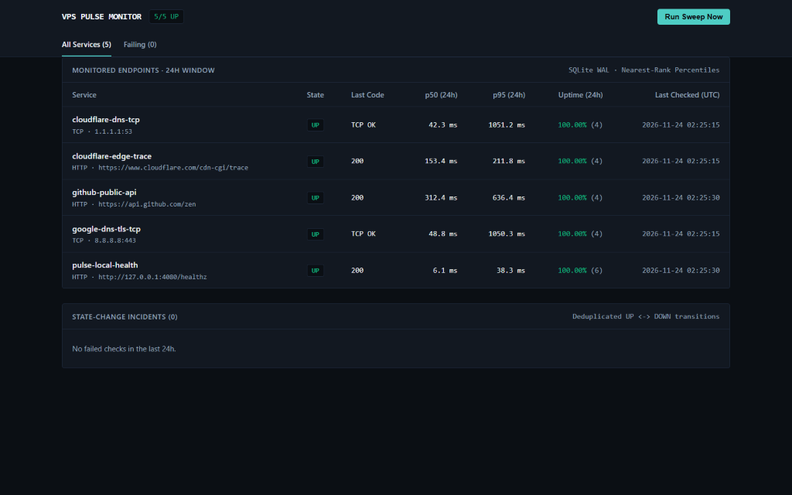
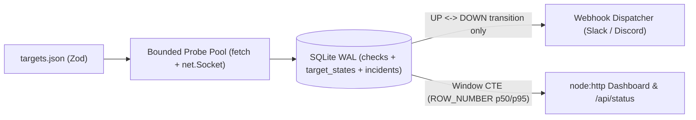

# vps-pulse-monitor

Single-process HTTP/TCP availability and latency monitor (`p50` / `p95`) backed by SQLite WAL with state-change webhook alerts.
Includes a `--once` CLI sweep mode and an embedded zero-framework Node.js HTTP status dashboard.



## Probe & Storage Pipeline



## Why It's Built This Way

- **In-Database Nearest-Rank Percentiles (`ROW_NUMBER() OVER`)**: 24-hour `p50`, `p95`, and `uptimePct` are computed inside a single SQLite CTE using integer ceiling index math (`CAST((cnt * P + 99) / 100 AS INTEGER)`), avoiding math-extension build flags and avoiding loading 86,400 raw check rows into the Node.js heap.
- **Unbiased Latency Distribution**: Percentile CTEs filter strictly on `is_up = 1` samples. Fast socket rejections (`ECONNREFUSED` in `<0.5 ms`) still count against 24h uptime, but cannot pull `p50` / `p95` response times artificially downward.
- **State-Change Alert Deduplication**: `recordCheck()` compares each probe against `target_states` inside an atomic SQLite transaction. Webhooks fire exclusively on `UP -> DOWN` and `DOWN -> UP` transitions (including exact outage duration in seconds), suppressing repeated `DOWN` noise during extended incidents.
- **Zero-Framework Embedded Dashboard**: `src/server.ts` serves semantic HTML + scoped CSS directly from `node:http` alongside `/healthz` and `/api/status`, keeping memory footprint minimal on small Linux VPS instances.

## Quick Start (3 Steps)

1. Install dependencies:
   ```powershell
   npm install
   ```

2. Run typecheck, build, test suite, or a single CLI sweep:
   ```powershell
   npm run build
   npm test
   npm run once
   ```

3. Start the continuous monitor + web dashboard on `http://127.0.0.1:4080`:
   ```powershell
   Copy-Item .env.example .env
   npm start
   ```

## Declarative Configuration (`targets.json`)

```json
[
  {
    "name": "api-gateway",
    "type": "http",
    "url": "https://api.github.com/zen",
    "intervalSeconds": 30,
    "timeoutMs": 3000,
    "expectedStatus": 200
  },
  {
    "name": "cloudflare-dns-tcp",
    "type": "tcp",
    "host": "1.1.1.1",
    "port": 53,
    "intervalSeconds": 30,
    "timeoutMs": 2000
  }
]
```

## Author

Carlos Almonte (**Haarls**) — [haarls.dev](https://haarls.dev) · [carlos@haarls.dev](mailto:carlos@haarls.dev)
